# Snapendance

Snapendance is an Android app built for the Intelligent Machines senior app developer assessment.
It combines two features in one APK:

- **Geo-fenced attendance** (native Kotlin + Jetpack Compose). Save the office location from the
  phone's GPS, watch the live distance to it, and mark attendance only within 50 meters.
- **Camera and resilient uploads** (Flutter). A custom camera with pinch zoom, a zoom slider, lens
  zoom presets, flash, and tap-to-focus captures photos into batches. Submitted batches go into a
  durable queue that uploads in the background, survives restarts, and retries automatically when
  the network returns.

**Release APK:** _link added at submission_

## Screenshots

All captured from the signed release APK on a Samsung Galaxy A04s (Android 14). Coordinates are
pixelated.

| Home | Attendance: in range | Attendance: marked |
|------|----------------------|--------------------|
| 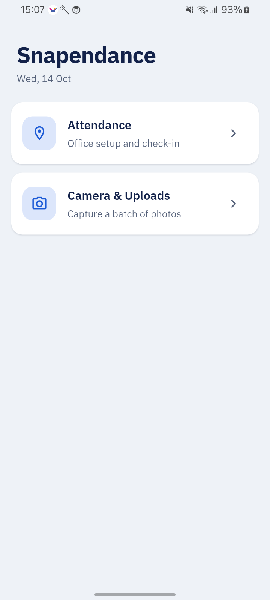 | 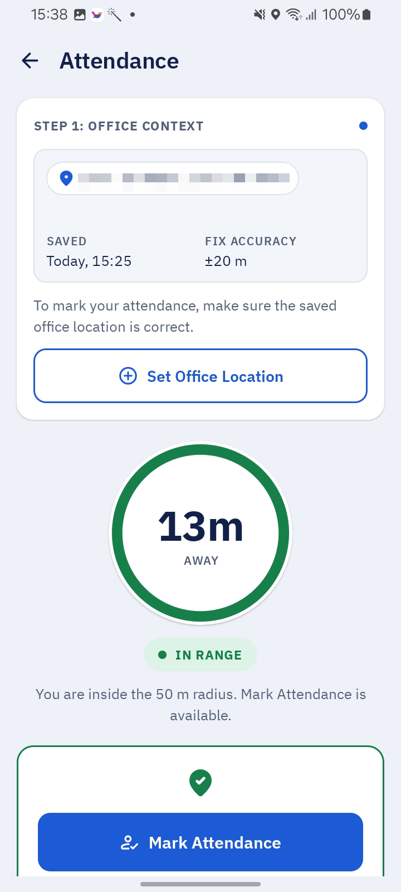 | 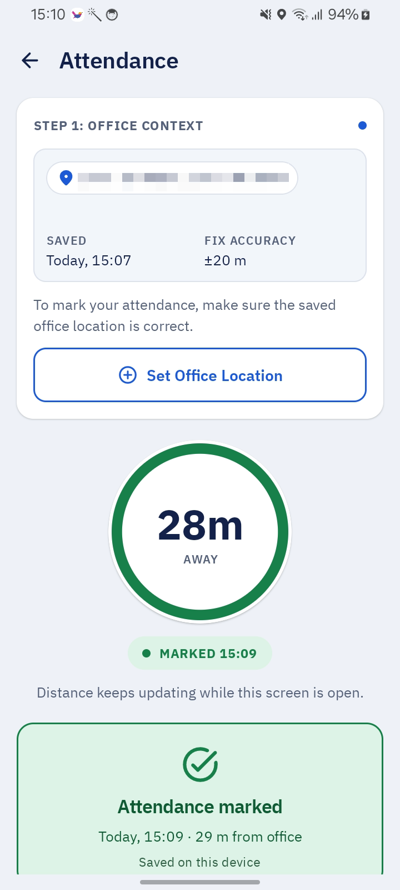 |

| Weak GPS blocks marking | Location services off | Camera: tap-to-focus |
|-------------------------|-----------------------|----------------------|
| 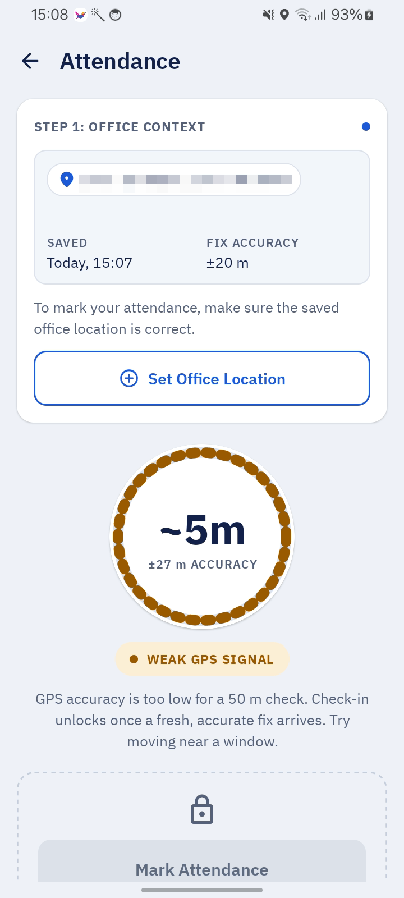 | 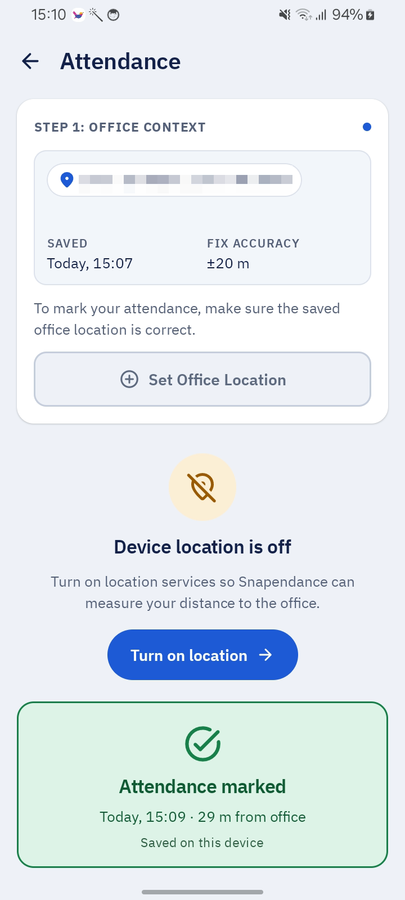 | 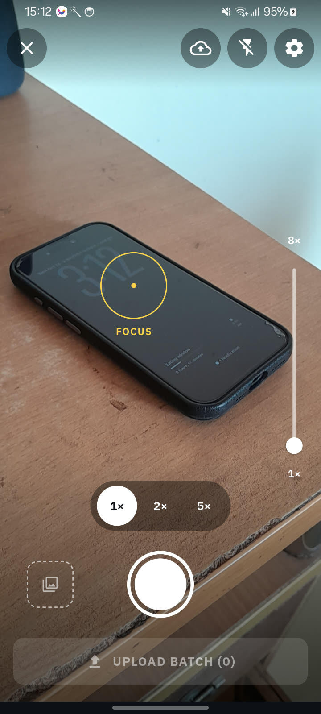 |

| Camera: batch of 3 | Upload Manager: uploading | Two batches queued offline |
|--------------------|---------------------------|----------------------------|
| 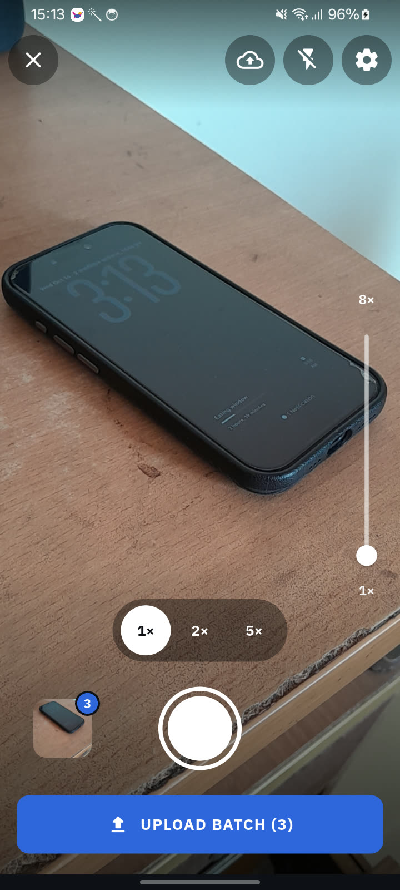 | 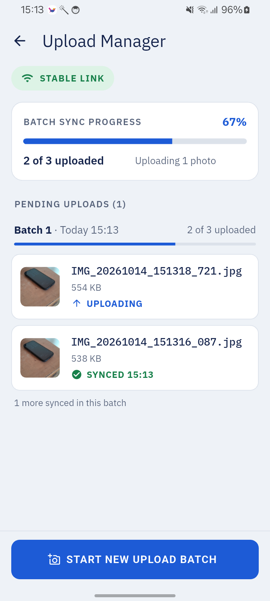 |  |

| Attendance: out of range | Mock API failure: retrying | Mock API scenarios |
|--------------------------|----------------------------|--------------------|
| 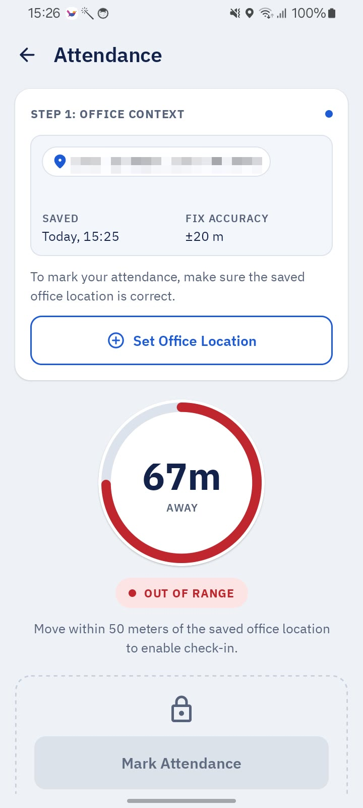 | 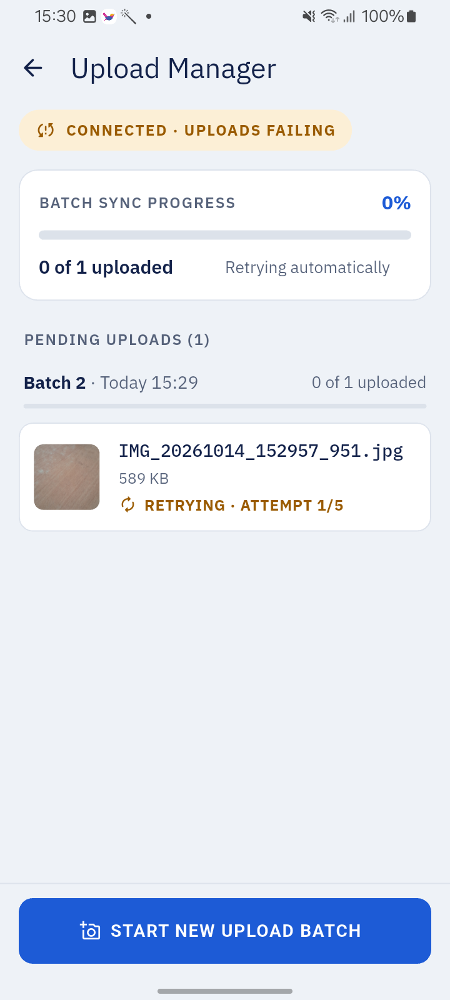 | 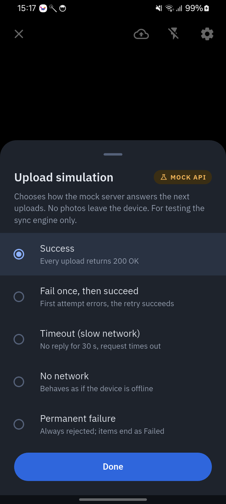 |

| Pinch, slider, presets, focus | Offline → online: automatic upload |
|-------------------------------|------------------------------------|
| 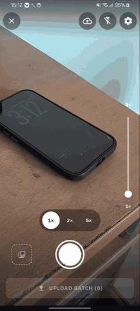 | 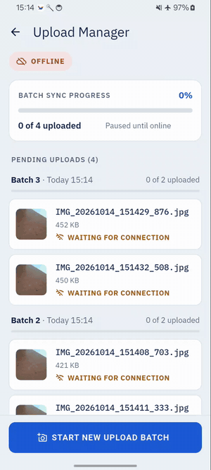 |

## Project structure and approach

### One APK, two UI stacks

The project is a Flutter app whose Android host also contains a native Compose screen. Flutter owns
Home, the camera, and the Upload Manager. Tapping **Attendance** on Home calls the
`com.shafayatb.snapendance/navigation` method channel (`openAttendance`), and `MainActivity`
starts the native `AttendanceActivity`. A second channel (`.../device`, `hasCameraFlash`) tells
Flutter whether the phone has a flash unit.

```
lib/                                  Flutter (Dart)
  main.dart, app/                     start-up, Home, theme, native launcher
  features/camera/
    data/                             CameraService over the camera plugin
    domain/                           zoom presets, tap → focus point mapping
    presentation/                     CameraCubit, CameraState, CameraPage
  features/uploads/
    data/                             sqflite database, queue repository, sync engine,
                                      mock upload API, WorkManager scheduler, connectivity
    domain/                           batch and item models, upload statuses
    presentation/                     BatchCubit, UploadsCubit, Upload Manager, mock API sheet
android/app/src/main/kotlin/com/shafayatb/snapendance/
  MainActivity.kt                     Flutter host and method channels
  attendance/
    location/                         Fused Location Provider source, fix policy, distance
    office/, marking/                 DataStore stores for the office and the day's mark,
                                      AttendanceEligibility (the 50 m rule)
    ui/                               AttendanceViewModel, AttendanceScreen and its cards
```

Both sides follow the same layering: the UI renders immutable state and sends user intents; a
Cubit or ViewModel owns the state; repositories and services own storage, hardware, and the
network. Widgets and composables never touch the database, files, GPS, or uploads directly.

### Flutter Cubits

| Cubit | Owns | Main intents |
|-------|------|--------------|
| `CameraCubit` | Camera lifecycle and controls: permission (denied / permanently denied), no camera, opening, ready, error; zoom within the camera's real range; flash Off/Auto/On (only with a flash unit); the focus marker. Releases the camera when the app pauses or the Upload Manager covers it and reopens it on return. | `start`, `retry`, `appPaused`/`appResumed`, `screenCovered`/`screenUncovered`, `setZoom`, `pinchStarted`/`pinchUpdated`, `cycleFlash`, `tapToFocus` |
| `BatchCubit` | The open batch being captured: photo count and last thumbnail, saving state, notices (capture failed, batch queued, empty batch). Submitting freezes the batch as queued and schedules the upload work. | `load`, `capture`, `submit`, `setScenario` (mock API), `appResumed` |
| `UploadsCubit` | The Upload Manager: queued batches with per-photo status (pending, uploading, retrying, uploaded, failed), attempt counts, last errors, and a connectivity hint. Polls the database while visible. | `start`, `load`, `retry`, `remove`, `appResumed` |

### Native attendance (Kotlin, Coroutines/Flow)

`AttendanceViewModel` exposes one `StateFlow<AttendanceUiState>` and a channel of one-off
`AttendanceEvent`s, and takes `AttendanceAction`s from `AttendanceScreen` (MVI). While the screen is
resumed and an office is saved, it tracks location updates and computes the distance.
`AttendanceEligibility` decides whether a mark is allowed: a saved office, precise permission,
location services on, a fix at most 30 s old with at most 25 m accuracy, and a distance of at most
50.0 m (no rounding, no hysteresis). **Mark Attendance** checks again with a fresh fix taken after
the tap, so walking away after the button turns on is caught. One mark per calendar day is saved in
DataStore. Permission denial, approximate-only permission, location services off, and weak or stale
fixes each have their own message and action.

### Durable uploads

- Each photo is saved as a file under the app's documents directory and recorded in `uploads.db`
  (sqflite) before the batch count goes up. Files stay on the phone after upload.
- Submitting a batch marks it queued and enqueues a unique WorkManager job (`upload-queue`) with a
  network constraint and exponential backoff from 30 s. A 15-minute periodic job is a backstop.
- The sync engine claims one photo at a time (claims expire after 2 minutes, so a killed run never
  leaves a photo stuck in "uploading"), calls the API, and records the result. Every attempt counts;
  after 5 the photo is **failed** and waits for a manual **Retry**, which resets its attempts.
  A photo whose file has disappeared is failed with "Local file missing" and can be removed.
- The upload API does not exist, so it is a mock (`MockUploadApi`) with repeatable scenarios:
  success, fail once, timeout (30 s), no network, and permanent failure. Choose one from the
  **MOCK API** sheet behind the camera's settings icon; the choice persists and applies to
  background runs. Everything else (GPS, camera, storage, WorkManager) is real.

## Generative AI usage

The app was built with **Claude Code** (Claude Opus 5.5) for requirements analysis, planning,
project rules, and implementation, and **Claude Design** for the UI design. The developer set the
rules, approved every plan and decision, and reviewed the work; tests were written first and the
app was checked on a physical phone after each task. The full record, with each session's prompts,
decisions, and evidence, is in [`docs/agent-log.md`](docs/agent-log.md). The essential prompts,
quoted as typed:

**Requirements review and task breakdown**

> Check out @Task_ Senior App Developer Technical Assessment.pdf and The @AGENTS.md . Anything
> needed to added or changed? Should there be more relevant references? What about spliting the
> work into separate tasks md file? Also rename CLUADE to CLAUDE

> 1.First the package became com.shafayatb.snapendance.snapendence. change it to
> com.shafayatb.snapendance
> 2. One conbined apk. so compose and flutter in the same project.
> And write the doc/tasks.

**UI design** (Claude Code wrote the Claude Design prompt; it is in the log)

> I want to create a claude design for this so give me a prompt. i will also upload the pdf with
> the prompt to claude design.

**Guard rails and Git workflow**

> Before we start shall we add pre hooks and post hooks?

> Are the git rules defined? like will this project follow git flow?

> Do not one shot a task. before commiting i want check the git difference. small task scope and
> commit is better. […]

**AI disclosure**

> before starting are you keeping an agent log? the requirement states that readme should include
> […] We can have the essential prompts in the readme then reference the agent log. What do you
> think?

**Running tasks.** Each task started from a short handoff file and an approved plan:

> run @FRESH_PROMPT.md

> Approved, one mark per day, start step 1

**Deadline triage**

> What do you think? Can this project be completed by 8pm tomorrow?

> I want you to commit, merge etc. There is no time to review things for now

How the work was organized: [`AGENTS.md`](AGENTS.md) holds the agent rules, `docs/tasks/` the
backlog, and `docs/plans/` one approved plan per task. Claude Code hooks in `.claude/` block edits to
protected files and run `dart format` and `dart analyze` after Dart edits. Each finished task was
checked by a separate read-only review agent before merging.

## How to run

### Requirements

- Flutter 3.44.6 (stable) with Dart 3.12.2
- JDK 17 and the Android SDK with platform 37 (compile SDK); minimum Android 7.0 (API 24)
- A physical Android phone is recommended: the camera and GPS need real hardware

### Build and run

```bash
git clone <repository-url> snapendance
cd snapendance
flutter pub get
flutter run                       # debug build on a connected phone
flutter build apk --release       # build/app/outputs/flutter-apk/app-release.apk
```

Release builds are signed with the key in `android/key.properties` when that file exists (it is
gitignored). Without it, a clone's release build is signed with the local debug key, so the command
above works as is.

### Tests

```bash
flutter analyze
flutter test                                       # Flutter unit and widget tests
cd android && ./gradlew :app:testDebugUnitTest     # native attendance unit tests
```

### Permissions

- **Location (precise)** for attendance. Approximate-only location is refused with an explanation.
- **Camera** for capture.
- **Notifications** are not requested; uploads run in the background without them.

### Using the app

1. **Attendance:** tap **Set Office Location** at the office, then **Mark Attendance** when the
   ring shows you within 50 m.
2. **Camera & Uploads:** capture photos, tap **UPLOAD BATCH** to queue the batch, and watch it in
   the Upload Manager (cloud icon). Start another batch at any time.
3. **Offline test:** pick a scenario in the MOCK API sheet (settings icon), or turn on airplane mode,
   submit a batch, then turn the network back on. The queued photos upload without opening the app.

## Background uploads: what to expect

- Uploads run in a WorkManager job that needs a network connection. Android decides when it runs:
  usually within seconds of the network returning, but Doze, battery saver, and app standby can
  delay it, and after a failure the next try waits for exponential backoff (30 s, then longer). The
  15-minute periodic job is a backup.
- Force-stopping the app (Settings → Force stop) cancels its scheduled work until the app is opened
  again; that is Android's rule for stopped apps. Swiping the app away from Recents should not cancel
  it on stock Android, though some vendors' battery managers do.
- The connectivity shown in the Upload Manager is a hint from the OS, not proof of Internet access.

## Known limitations

- The upload API is a mock; there is no backend.
- Only the first back camera is used. Phones that expose ultra-wide or telephoto as separate
  cameras reach them only through the zoom range the first camera reports.
- The attendance screen notices location services being switched off at its 30 s stale check, not
  instantly. It is portrait-only, because a configuration change would cancel a running GPS fetch.
- If a zoom, flash, or focus call fails in the hardware, the UI still shows the new value.
- A camera permission left as "don't ask again" from an earlier install can show as plain "denied",
  where **Allow camera access** does nothing; grant it in system settings.
- "Marked today" refreshes when the attendance screen resumes, not at midnight while it stays open.
- The camera plugin merges `RECORD_AUDIO` and `WRITE_EXTERNAL_STORAGE` into the manifest although
  still capture needs neither.
- iOS is not supported (`ios/` is unused starter scaffolding).

Tested on a Samsung Galaxy A04s (Android 14).
